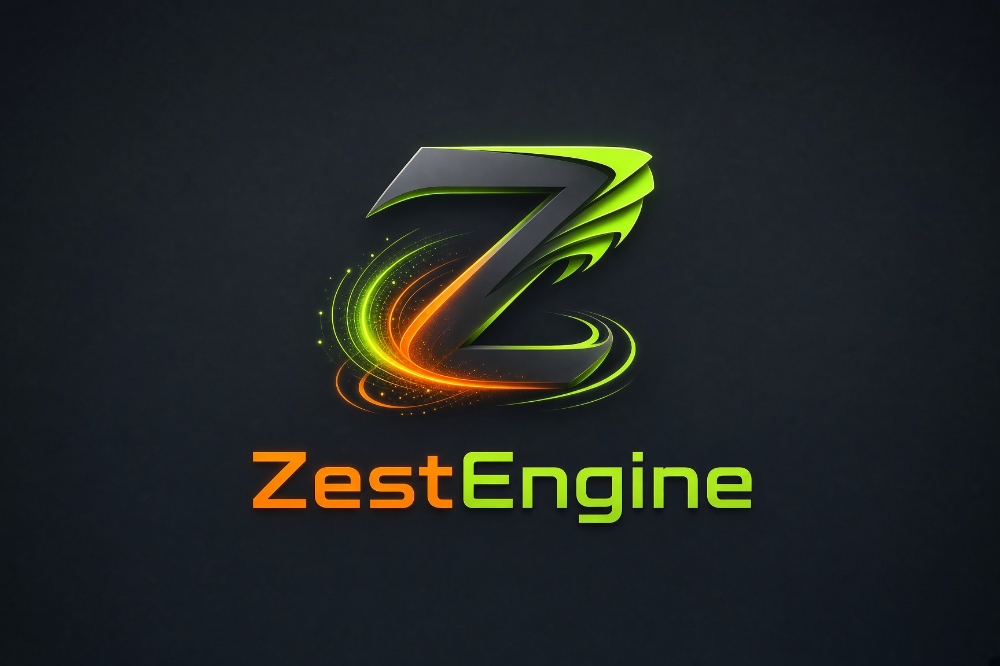

# zestengine

ZestEngine is a standalone 3D game engine in Rust + Vulkan with a dockable in-engine
editor. It's a general-purpose desktop + VR engine: scenes, materials, FBX/glTF
import, a component + hot-reloadable Rust-plugin system, custom shaders and a
visual shader graph, realtime global illumination (**Flux** — see below), a
lighting bake, audio (Steam Audio + voice chat), physics (rapier3d), water
simulation, networking, OpenXR VR, and building standalone games straight from
the editor.



## Documentation

The documentation website is at **<https://lemonxah.github.io/zestengine/docs/>**.

- [ECS Guide](ECS.md): components, systems, stages, events and entities, with tested examples.
- [Engine API Guide](ENGINE_API.md): how to move things, spawn things, raycast, play sounds, read
  input, save and network.
- [WASM Guide](WASM.md): sandboxed WebAssembly scripts for user-generated content and mods.
- [Rust API reference](https://lemonxah.github.io/zestengine/docs/api/zestengine_core/index.html),
  generated from the doc comments (every item links back to the matching guide section).

The guides are plain Markdown in this repository and the examples in them are compiled by
`cargo test -p zestengine-core --test ecs_guide`. The website is built from `website/` by
`.github/workflows/docs.yml`; to preview it locally run `mdbook build website` (or
`mdbook serve website`) and `cargo doc -p zestengine-core --no-deps`.

## License and attribution

ZestEngine is **source-available, not open source**, under the
[ZestEngine License v1.1](LICENSE). You can inspect and modify it for your
projects and ship commercial games and applications without royalties.
You must give visible ZestEngine credit and include [LICENSE](LICENSE) and
[NOTICE](NOTICE) with products containing its code. Giving credit does not
permit redistribution of the engine, shader libraries or competing tools.

The license covers shader source and compiled or baked shader programs,
including translations and modifications. Keep notices, identify your changes, and
do not claim original authorship of ZestEngine code. Your independently
created game code and assets remain yours. Rendered images, videos and baked
lighting data are not shader programs merely because ZestEngine made them.

For bug reports and discussion, section 4 permits limited public excerpts;
it also permits contribution patches submitted to the official project.
It does not grant general permission to publish engine forks. Contact the
maintainer through the [official repository](https://github.com/lemonxah/zestengine)
for permissions outside the license. The license text controls this summary.
Third-party licenses and permissions already granted for earlier versions
(including BSD-3-Clause releases) remain applicable to that material.

The shader math, buffer conventions and GPU validation are documented in
the current Flux implementation.

## Flux — realtime global illumination

Flux is ZestEngine's built-in realtime GI: a Lumen-style screen-space technique that
needs no bake and no RT cores. Each frame it places sparse screen-space probes
(one per 4x4 pixel block), reconstructs world position + normal from a depth
prepass, and cosine-traces them against a cached **Global Distance Field** — a
merged 3D distance + nearest-instance texture built from per-mesh SDFs. Emissive
surfaces are sampled analytically as sphere area lights (NEE), so emitter bounce
is smooth instead of noisy. Results temporally accumulate with reprojection (and
a per-frame jittered seed so the noise actually converges), are bilaterally
upsampled to full resolution in the forward shader, and feed back into the next
frame's trace for cheap multi-bounce (a radiance cache).

The whole trace is folded into the main command buffer — no extra submits or
fence stalls, on the order of 0.06 ms/frame of CPU. The result is soft,
atmospheric, and fully dynamic: move a light or an emissive object and the bounce
updates live. It's tuned per-scene in the Environment tab (intensity, quality
preset, bounces, smoothing, GDF resolution). Baked lightmaps stay available as
the zero-runtime-cost path for VR / low-end targets (mixed lighting).

## Stack

| Concern | Choice |
|---|---|
| Graphics | Vulkan 1.3 via [ash](https://crates.io/crates/ash) (dynamic rendering, sync2) |
| Realtime GI | **Flux** — screen-space probes marching a global distance field (no bake, no RT cores) |
| Lighting bake | Vulkan ray query (VK_KHR_ray_query / acceleration_structure) |
| VR | OpenXR via the [openxr](https://crates.io/crates/openxr) crate (Monado / SteamVR runtimes) — desktop landed, Quest on-device validation pending |
| Editor GUI | [egui](https://crates.io/crates/egui) + egui_dock, rendered in-engine |
| Worlds/props | glTF 2.0, FBX (ufbx) |
| Avatars | VRM (glTF extension): humanoid rig, expressions, spring bones; Bone Cloth for hair / skirts with auto-fitted body colliders |
| Audio | [rodio](https://crates.io/crates/rodio) (.wav/.flac/.mp3), Steam Audio spatialisation, Opus voice chat |
| Shaders | zestengine standard uber-shader (Poiyomi-inspired) + runtime custom GLSL + the visual shader graph |
| Windowing | winit |

## Workspace layout

```
crates/
  zestengine          binary entry point (desktop + VR)
  zestengine-core     egui-free runtime API: ECS data/systems, ObjectId/Ref
  zestengine-engine   shared world runtime, simulation, input, audio, networking
  zestengine-render   ash Vulkan renderer (context, swapchain, frames, bake)
  zestengine-xr       OpenXR session/swapchains/input
  zestengine-assets   glTF/FBX, .material/.scene/project files, bake sidecars
  zestengine-editor   egui editor panels (inspector, files, code editor, components)
  zestengine-hub      project launcher window (recent projects, templates)
  zestengine-relay    networking relay service and wire protocol
  zestengine-server   dedicated game server and administration tools
  zestengine-plugins  native component plugin loading and reload lifecycle
  zestengine-scripting WASM sandbox layer (shared engine, limits, module checks)
  zestengine-text     CPU text shaping, layout, glyphs and atlas management
  zestengine-render-lite render-free compatibility for headless builds
plugins/
  components      example Rust component plugin (Orbit)
```

A shipped game uses `zestengine-engine` and the shared contracts in
`zestengine-core`, without depending on the editor. Plugin inspector/gizmo code
is gated behind the plugin's `editor` feature.

## Features

Highlights of what's already in:

**Rendering** — PBR standard shader (metal/rough, normal/emission); directional
/ point / spot lights with shadow maps; procedural + equirect skybox; always-on-top
selection outline; camera preview tab; stats overlay; vsync toggle. Also in:
GPU-driven culling with indirect draws (compute frustum + two-phase Hi-Z); up to
four blended reflection probes per pixel (forward, SSR and ray-traced reflections);
render-to-texture cameras with nested screens and portals; deferred projected
decals (depth + normal from the G-buffer); water with shore-calm waves and ripples
across the raster, displaced and RT-reflection paths; per-instance material
colour/parameters (`PerInstance`) without breaking instanced batches; **AMD FSR 3**
temporal upscaling with frame generation (frame interpolation) on HDR inputs;
ray-traced reflections (Vulkan ray query) and screen-space reflections; bloom;
volumetric fog; planar reflections; baked lightmaps + light probes; occlusion
culling; GPU instancing and meshlet LOD generation; mobile/desktop render tiers.

**Assets & formats** — glTF and FBX import; built-in primitives; `.material`,
`.scene`, and `project.zestengine` files; `.wav`/`.flac`/`.mp3` audio; heightmap
terrain import (PNG/JPG/EXR/HDR); `.shadergraph` node graphs, `.seq` sequencer
timelines and `.behaviour` behaviour trees (all RON, hot-reloadable).

**Editor** — dockable panels (egui_dock); transform gizmos (move **W** / rotate
**R** / scale **E**) with snapping, pivot/orientation modes, camera-relative
handles; scene tree with reparenting; Unity-style project file browser (with LSP
problem badges, live FS updates); unified inspector; play mode; undo/redo;
viewport widget filter and billboards; log console. Plus dedicated tabs: a
**Shader Graph** node editor with GLSL codegen, a **Sequencer** timeline for
cinematics, terrain tools (heightmap import + splat paint), a behaviour-tree
editor, and the Animation / Animator Controller editors.

**Code editor** — dockable tabs with syntect highlighting, line numbers,
debounced auto-save; rust-analyzer LSP (diagnostics, completion, hover,
go-to-definition, references); a **vim mode** (motions, operators, visual,
`:` command line with live regex `:s`/`:%s` preview, undo/redo, `gd`/`gr`).

**Components & scripting** — `TypedComponent` system with built-ins
(Light, Camera, Audio, Colliders, Spin, Bob, Light Probe Volume, Terrain,
Decal Projector, Per Instance, Vehicle, Perception / Behaviour Tree); cargo-built,
hot-reloadable **Rust plugins** (runtime behaviour in `zestengine-core`, editor
inspector/gizmo behind an `editor` feature); stable **object identity**
(`ObjectId` UUID) with `ObjectRef` cross-object references set by dragging from
the Scene tree; a native system API (`ecs::ObjectContext`) for transforms (incl.
parent-aware world writes), object lookups, and runtime scene switching; runtime
custom **GLSL shaders**; a sandboxed **`Wasm Script`** component (wasmtime, no
host I/O, fuel + memory caps; see the [WASM Guide](WASM.md)) for user-generated content and mods; humanoid animation
**retargeting** between skeletons..

The **ECS migration** uses `zestengine_core::ecs::SceneWorld` (hecs) for saved-ID
lookup, parenting, world transforms and inherited activation. Native systems
query a `SystemWorld` view; `ComponentSet` provides ordered, borrow-checked views
of the same permanent typed values for scene editing.
Plugins register data with `register::<T>()` (`register_ecs` is an alias) and systems with
`register_system(name, Stage::Update, system)`. Inspector and gizmo registration
stays the same. Spin, Bob, Pawn, first/third-person characters, follow cameras,
constraints, VR rigs/grabbing/avatar following, health/weapons/target dummies/HUDs,
vehicle/ownership controls, perception, behaviour trees, trigger/animation event bindings,
click-to-move/interactables and RTS camera/selection/resources/rings and the
example Orbit plugin use this path; new component
templates generate ECS systems. Registered built-in component data is available
to systems too. Runtime components stay in typed ECS storage across stages,
preserving unsaved state and duplicate instances. Lights, reflection probes,
planar layers, post volumes, audio, navigation candidates, wind/wave riders,
physics object discovery, vehicle suspension, terrain/joint updates, water forces,
ripple stepping and replication selection use typed archetype queries. UI layout,
interaction, painting, world-canvas selection and 3D text preparation borrow native
components and hierarchy links. Audio geometry, probe volumes and environment
regions also read native data, preserving duplicate-volume order and prefab isolation. 2D physics planning, body/collider construction, joints and tilemap sync
also read native ECS data, retaining authoring order for deterministic collider
creation and duplicate instances. 3D body/collider and terrain-layer construction also read native ECS data, including authored model collision and shared mesh-shape caches. Explicit dirty collider edits and toggles refresh changed shapes while retaining body and joint handles, motion and network handover. Physics pose synchronization and mass reporting access native ECS data;
dynamic ancestors are interpolated before their children, independent of scene order. Object animation rigs and pose writes access the native
world directly. Saved IDs are indexed back
to deterministic scene-tree order. Saved identities, local transforms, names,
enabled state, source provenance, render slots, layers, static flags and object
and component network roles are authoritative ECS data shared by the editor and
native systems, including snapshot restore and moves between scenes. Render-slot
iteration holds checked views without copying its backing vector. Parent entity
links are authoritative too; scene-tree order is a derived index, and prefab
reconciliation retains live entities while resolving its replacement hierarchy.
Native startup, fixed/update/late stages, scripts, contacts and actions use registered ECS systems; the old component lifecycle callbacks and context dispatcher are removed. Navigation steering, character sweeps/rewinds and network prediction/replay also borrow native ECS data. Scene replication also borrows native settings, animator/avatar data and hierarchy links directly, resolves saved IDs without scene snapshots, and applies received parent poses before children. Avatar parameter roots remain cached by saved identity when scene rows move. Remaining engine subsystem and render preparation conversion is still in progress.
Native systems receive borrowed physics/navigation, network, UI and previous-frame event services via
`SystemContext.services`; `SystemContext::new` supplies an empty standalone context.
Use `context.events::<T>()` to read typed events and `context.emit(event)` to
queue one for next frame. Native transform and sibling-data edits are immediate.
`Stage::Gameplay` runs after Update movement commands resolve, so hitscan weapons
read current camera/hand poses and physics positions. Shots update Health and
particle data directly, followed by death handling and target-dummy respawn logic.
HUD bindings run in LateUpdate and read the resulting gameplay/UI state.
`Stage::Events` receives immediate 2D/3D contacts and animation markers through
`services.scene_events`. Trigger and animation bindings queue `queue_actions`
requests; the host resolves targets, argument properties and duplicate labels
against live native data after queries finish. Action dispatch lends disjoint
same-type instances from a checked query, so an action can read a sibling or
another object's same-type properties without copying component values.
`services.components` supplies authoring slot metadata only; payload access uses
`NativeProperties`/`ComponentSlot::read_in`, never the legacy callback lookup cache.
Binding requests retain warn-once/cache state; normal cloning and saved scenes reset it.
Top-down and RTS kits use native pointer projection, navigation targets, selection
flags, UI rectangles and resources. Click-to-move updates its sibling agent and
requests interactions before the native interaction system runs. Interactables
retain authority/RPC routing and queue bindings through the same native dispatcher.
Selection rings update in LateUpdate; RTS cameras and target markers support parents.
`register_system_for::<T>` skips a system when its typed data is absent, including
skipping unused stage hierarchy work. Perception runs before behaviour trees,
reads current native transforms, and Chase steers the owning Nav Agent toward its
perceived target. Tree actions write native navigation/animator data directly;
emitted events remain deferred to the next frame.
`Stage::Start` initializes new active component instances before movement. Existing
instance state survives disabling and reenabling; replacement instances initialize
on already-running objects. Initialization systems track completion in their ECS
data; the stage can repeat when startup commands spawn more objects.
Native controllers use `ObjectContext` to read/write
actual ECS transforms and sibling data while sharing the same movement step as
prediction replay. Parented camera poses use world-to-local conversion, and
constraints capture their rest pose during initialization before motion starts.
VR tracking and locomotion use the same native access, including remapped controller
input and prediction replay. Grabs reserve live component state immediately in scene
order; held objects and teleport markers use world poses even under a parent.
Disabled payloads also stay inline in typed `DisabledComponent<T>` columns;
ordinary `T` queries select enabled instances, while disabled data remains
available to native queries and inspector/gizmo views. The old boxed `Disabled`
constructor is normalized when inserted; it is not retained as live scene data.
Plugins must be rebuilt together with the engine (plugin ABI version 1; it is bumped on incompatible changes from the first release) with matching host dependency features.
The ABI stamp checks shared Rust type identities and layouts before a library is registered;
for a workspace server plugin, build both packages together with
`cargo build -p zestengine-project-components -p zestengine-server --lib`.

**Projects & game builds** — **File → New Project** scaffolds a standalone cargo
project (`scenes/ materials/ shaders/ textures/ src/main.rs` + a `plugins/components`
crate + `project.zestengine`) that builds and runs immediately; **File → Project Settings**
sets the starting (boot) scene; **File → Build Game** (or `zestengine --build`) compiles a
**standalone executable + bundled `assets/`** under `build/`. **File → Build Game for
Windows** (or `zestengine --build <dir> --target windows`) cross-compiles from Linux with
`cargo xwin` into `build-windows/` (needs `cargo install cargo-xwin` and
`rustup target add x86_64-pc-windows-msvc`). A shipped game links the
runtime only (`zestengine-engine` with the editor cargo feature off), so no editor/egui_dock
in the binary; the boot scene comes from `project.zestengine` and is overridable in the
editable `src/main.rs`. Unsaved-changes prompt on exit.

**Animation & avatars** — keyframe Animation tab with a curve/tangent editor;
Animator Controller state machines with sub-state machines; GPU skinning; humanoid
IK (11 tracker roles, procedural stepping), full-body tracking, and animation
**retargeting** between skeletons; Bone/Mesh cloth with self-collision and
auto-fitted colliders, VRM spring bones; face tracking (OpenXR + OSC), lip sync
and voice-driven visemes; LOD generation via quadric-error decimation with meshlet
clusters.

**Water & simulation** — ocean / lake / river bodies with Gerstner waves and shore
calm; buoyancy, drag and flow; interactive ripple fields; shallow-water simulation
with beaches, run-up and fluid templates; underwater view and audio; waterfalls;
carryable water; swimming (desktop + VR).

**Networking** — UDP sessions with an authenticated relay, hole punching and host
migration; client-side prediction with lag compensation (`ray_cast_rewound`)
surviving migration; Argon2id passphrases and Ed25519 identities with allow / ban
lists; world, avatar and voice sync.

**VR** — OpenXR on desktop (multiview, controller input, in-headset world/avatar
editing); VR templates; Android / Quest builds (Vulkan 1.1 fallback, ASTC;
foveation pending on-device validation).

**Content & templates** — UGC content packages with the sandboxed `Wasm Script`;
asset cooking into `assets.pak`; localization; the save API; the event bus
(`ctx.emit`); seamless + additive multi-scene loading; project templates (FPS,
TPS, top-down, strategy, card, novel, VR shooter, VR social).

**Audio** — spatial / non-spatial `AudioSource` + `AudioListener` with distance
attenuation, driven in play mode; Steam Audio spatialisation; the bus mixer; Opus
voice chat with proximity.

**Physics / collision** — Box / Sphere / Capsule / Mesh colliders with editable
viewport widgets, a `RigidBody` component driving a rapier3d simulation (gravity,
collisions, transform writeback) in both the editor's Play mode and a built game,
joints, raycast/overlap queries and trigger events, terrain trimesh colliders, and
a wheeled **Vehicle** (raycast suspension, steering, throttle/brake, grip).

**Lighting bake.** A GPU lightmap + light-probe bake (Vulkan ray query: BLAS/TLAS,
path-traced direct + soft shadows + multi-bounce indirect, SH-L1 probes) with a
"Baker's Man" editor tab and `.lightmap` / `.reflprobe` sidecars. Runtime
sampling: per-fragment probe SH-L1 for the indirect term and per-object
lightmaps sampled by `uv1` for static geometry — in both the editor and a built
game (the sidecars bundle with the scene). Bakes ship compressed: BC6H lightmaps
and probe cubes with E5B9G9R9 / RGBA16F fallbacks for GPUs without BC, ASTC on
Quest builds; the Baker tab shows the measured lightmap error against the raw
bake. The standard shader's PBR is energy-conserving (Cook-Torrance Fresnel kS /
diffuse kD).

## Planned

Much of the planned work has landed: player controllers, the input binding system,
the in-game API, the game UI system, physics joints/queries/triggers, VR
(OpenXR on desktop), networking, and the content pipeline. What remains:

- **Hardware validation** — Android/Quest on-device run + `XR_FB_foveation`, and a
  native Windows toolchain run. Both targets currently only cross-build.
- **Terrain + foliage** — heightmap terrain with splat materials landed
  (2026-11-01); foliage scatter, per-texel splat control, chunking/LOD remain.
- **Projected decals** — deferred box-projector pass landed (2026-11-01);
  normal-bent projection, emissive/alpha modes and transparent surfaces remain.
- **Visual shader graph** — node editor + GLSL codegen landed (2026-11-01);
  more node types, sub-graphs and a live material preview remain.
- **Humanoid retargeting** — role-based skeleton/clip retargeting between rigs is
  implemented, including reference-pose alignment and hip translation scaling.
  Full-body and foot IK exist separately; IK-aware retarget constraints and a
  dedicated retargeting UI are not implemented.
- **GPU instancing** — GPU-cull scene batches can merge material variants when
  they share the mesh, descriptor set and push-constant values. Per-instance
  overrides support base colour and one parameter vector (metallic, roughness,
  toon steps and toon/PBR blend). Batching across distinct descriptor sets and
  additional per-instance parameter vectors are not supported.
- **Logic in UGC (WASM scripts)** — the sandboxed `Wasm Script` component (wasmtime, no
  host I/O, fuel and memory caps) works in content packages and mods; its actions and
  properties appear in event bindings (see the [WASM Guide](WASM.md)). The older `Script`
  component (`env` imports) is a prototype that packages and mods reject. A wider host API surface remains.
- **Cinematics / sequencer, AI behaviour trees + perception, vehicle / destruction,
  virtual shadow maps / meshlets** — first increments in flight.
- **Console platforms** — groundwork only: a bring-up plan, no SDK in the repo.

## Roadmap (milestones)

- [x] **M1 — Foundation**: window + Vulkan device + swapchain, frames in flight,
      resize/out-of-date handling
- [x] **M2 — Meshes & materials**: depth, orbit camera, glTF/FBX import, zestengine
      standard shader phase 1, variant cache, egui material inspector with live edits
- [x] **M3 — Assets**: full glTF scenes, VRM avatar import (rig, blendshapes,
      spring bones), skinned animation
- [~] **M4 — VR**: OpenXR session sharing the Vulkan device, stereo rendering
      (multiview), head/controller tracking, locomotion + grab — landed on desktop;
      Android/Quest on-device validation still pending
- [x] **M5 — Editor**: dockable editor, gizmos, hierarchy, materials,
      components/plugins, code editor
- [x] **M6 — Networking**: world/avatar sync, voice, IK replication
- [x] **M7 — Content pipeline**: publishing format, mobile-tier shader validation,
      content sandboxing (the sandboxed `Wasm Script` component)

## Running

### Development commands

The root `justfile` follows the same workflow as ZestBay. It requires `just`,
Bash, Python 3.11+ (for `tomllib`), and the Rust toolchain. Native builds also
need `glslc`, the Vulkan loader/drivers, ALSA and udev development libraries,
and libclang for Steam Audio's bindings. Steam Audio's SDK downloads on its
first build.

```sh
just                          # list recipes
just current                  # workspace version
just check                    # check every workspace target
just test                     # workspace tests
just fmt                      # format Rust sources
just build                    # release workspace build (editor, hub, relay, example plugin)
just run [project-dir]        # editor on this checkout's project, or another project
just hub                      # Project Hub (builds its editor)
just install prefix="$HOME/.local" sudo=""   # user install; defaults to prefix=/usr with sudo
just bump 0.2.0               # update workspace version + Cargo.lock
just release 0.2.0 "changes"   # bump, commit, tag, push, GitHub release
just deb                      # build a .deb in an Ubuntu 24.04 container
just rpm                      # build an .rpm in a Fedora container
just nix                      # build with Nix (result symlinked at ./result)
```

Installation puts the editor, hub, relay and `libphonon.so` together under
`<prefix>/lib/zestengine`, links them in `<prefix>/bin`, and installs a desktop
launcher + icons. `just install` targets `/usr` via sudo by default; for a user
install use `just install prefix="$HOME/.local" sudo=""` and put `$HOME/.local/bin`
on `PATH`. Keep this source checkout available: generated game projects use
local engine crate paths. The install is a local developer install.

`bump` changes `[workspace.package].version` (inherited by the engine crates)
and updates the lockfile offline; the example plugin and standalone game
examples keep their independent versions. `release` requires a clean working
tree, a branch with an upstream, and authenticated `gh`. It commits the version
files, creates `v<version>`, pushes the branch and that tag to `origin`, then
creates a GitHub release with generated notes. It does not upload build artifacts.

```sh
cargo run --bin zestengine                      # the project in the current folder, else the Project Hub
cargo run --bin zestengine -- <project-dir>     # open a project directly
cargo run --bin zestengine-hub                  # the Project Hub
```

Open a model or scene directly: `cargo run -- world.glb` / `model.fbx` /
`scenes/world.scene` (the project is the folder above it holding `project.zestengine`).

### Project Hub

`zestengine-hub` (or `zestengine --hub`, or **File → Project Hub** in the editor) lists recent
projects (pin, search, sort, show in file manager, locate moved ones), creates new
projects from the templates and opens projects in the editor, which runs as its own
process (`zestengine <project-dir>`). The editor is found next to the hub executable; set
`ZESTENGINE_EDITOR` or the path in the hub's Settings otherwise. The recent list lives in
`<config>/ZestEngine/projects.ron` (the editor records every project it opens there too),
hub preferences in `<config>/ZestEngine/hub.ron`. A `thumbnail.png` in a project's root (or
its `.zestengine/` folder) is shown as its picture.

### Editor

Dockable layout (drag tabs to rearrange): **Viewport**, **Scene**, **Inspector**,
**Files**, **Log**, **Baker**, **Environment**, **Camera**, **Code**, **UI
Editor**, **Animation**, **Animator Controller**, **Shader Graph**, **Sequencer**,
**Occlusion**, and **Project Settings** tabs. Menu bar: File (new project,
project settings, build game, new/open/save scenes), Edit (undo/redo), Tools
(plugins, bake), View (stats, layout, camera preview), Help.

| Input | Action |
|---|---|
| Left click (no drag) | Select object (purple outline) |
| Left drag | Orbit selection / viewport center (Alt: force orbit over gizmo) |
| Escape | Deselect |
| F | Focus selected object |
| W / E / R | Gizmo: move / scale / rotate (also buttons in the viewport) |
| Right mouse (hold) | Mouse-look (cursor hidden) + WASD/Q/E fly, Shift fast |
| Middle mouse drag | Pan |
| Scroll | Dolly (over the viewport) |
| Ctrl (while dragging gizmo) | Snap to grid; while rotating, snap to 15° |
| Play / Stop | Run components (menu bar); Stop restores the pre-play state |
| Ctrl+S | Save scene |

Viewport overlays: gizmo tool buttons (top-left); pivot mode, orientation, snap +
grid size (top-center); widget filter (top-right).

`RUST_LOG=debug` for verbose logs. Install `vulkan-validation-layers` to get
validation automatically in dev.

### Building a game

From the editor: **File → New Project** to scaffold one, **File → Project Settings**
to pick the boot scene, **File → Build Game** to produce `build/<game>` + `build/assets/`.
The same is available headless:

```sh
zestengine --new-project <parent-dir> <name>   # scaffold a project
zestengine --build [project-dir]                # cargo build --release + bundle assets
zestengine --build <dir> --target windows       # cross-compile with cargo xwin
```

Windows builds need `cargo install cargo-xwin` and
`rustup target add x86_64-pc-windows-msvc` (also available in the editor as
**File → Build Game for Windows**). The output `build/` folder is self-contained
and relocatable; run the executable inside it.
